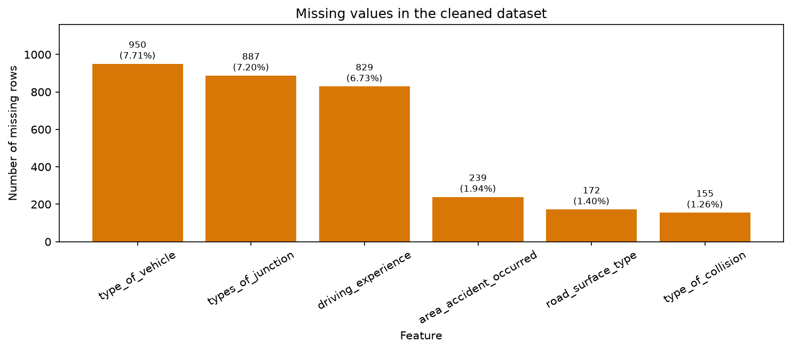
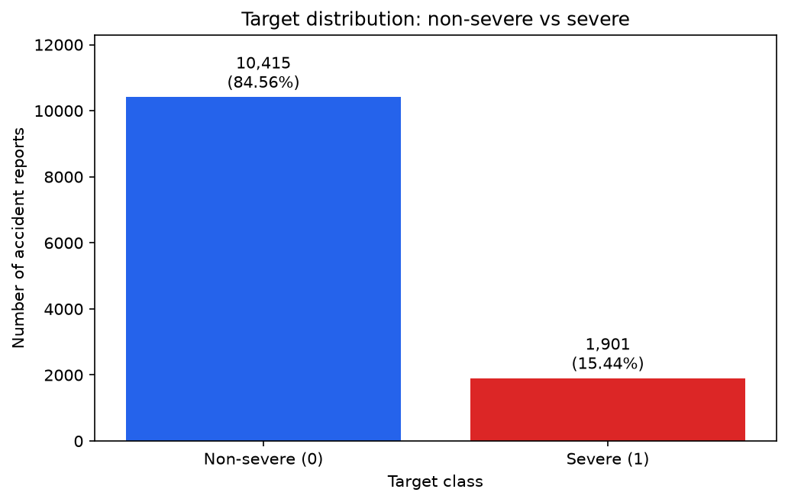
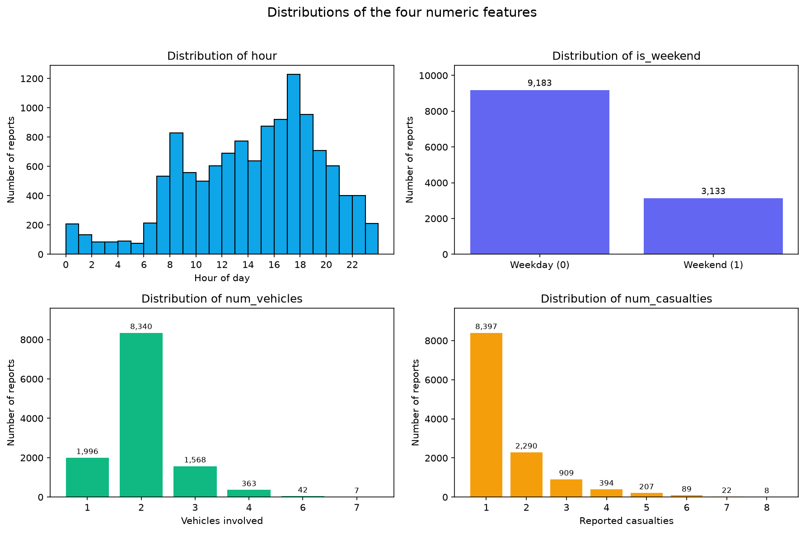
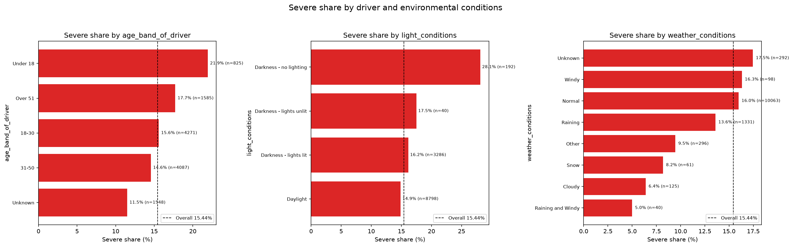
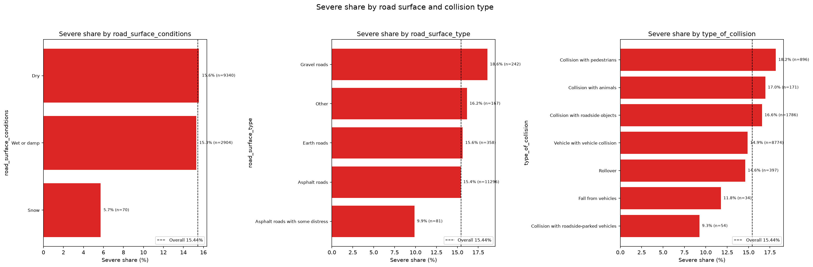
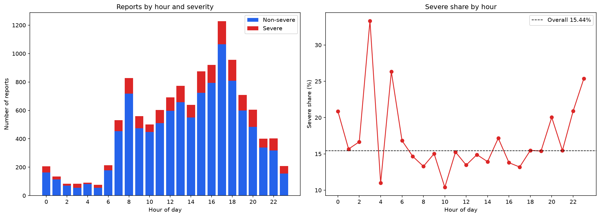
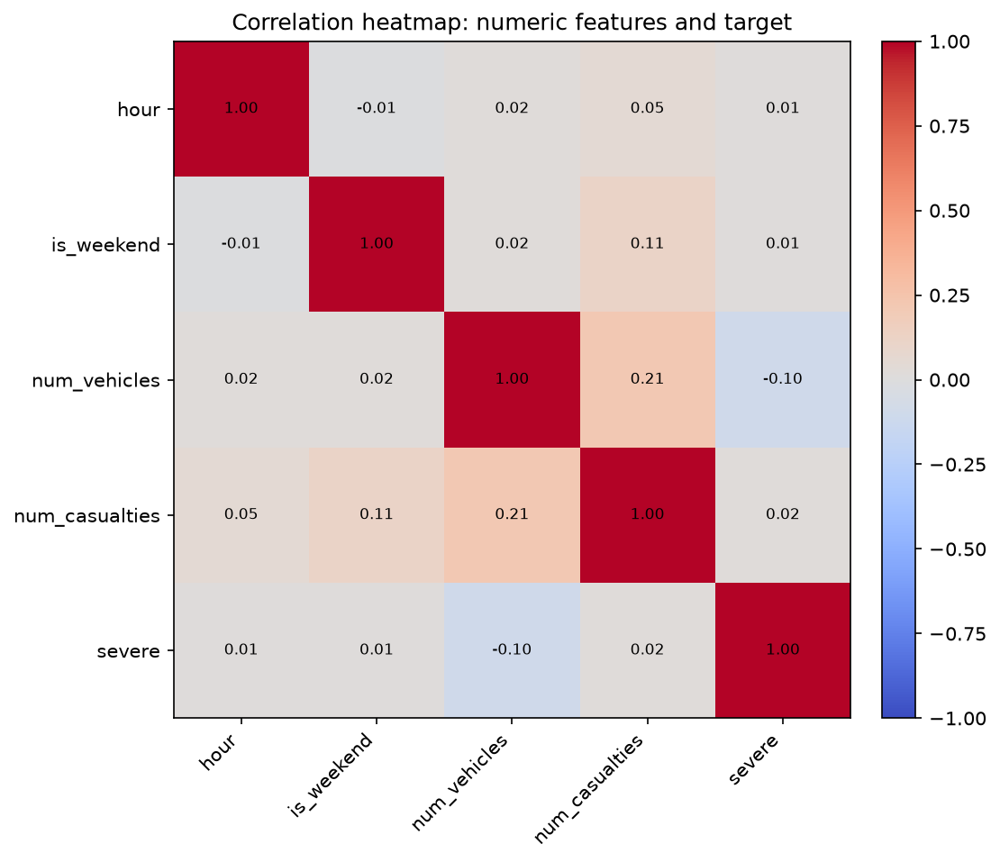
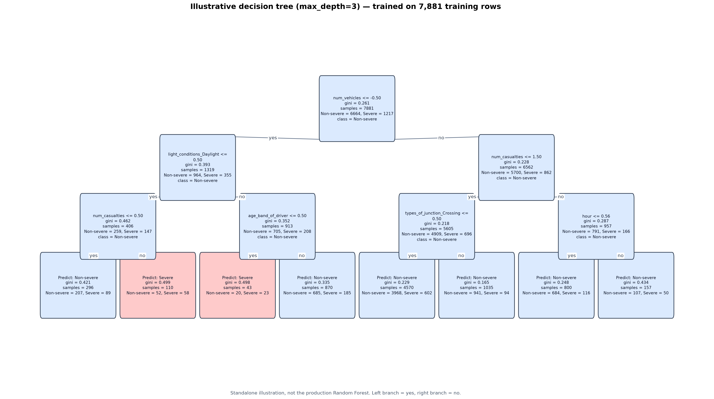

# Accident Severity Classification with MLOps

**Course:** CSL236 – Introduction to AI and Machine Learning, B.Tech CSE, Semester 5, The NorthCap University
**Project type:** End-term MLOps system (reproducible preprocessing → tracked experiments → validated API → tests → Docker → CI → deployment configuration)
**Repository:** [https://github.com/vidhi1686/Road-accident-prediction](https://github.com/vidhi1686/Road-accident-prediction)

| Team member | Roll number | Contributions |
| --- | --- | --- |
| Vidhi Jindal | 24csu324 |
| Palak Khanna | 24csu325 | 

---

## 1. Project objective

This project classifies the **severity of a reported road accident** from
accident-report information. It is a **binary classification** system:

- `Non-severe` (0): the report records a slight injury.
- `Severe` (1): the report records a serious or fatal injury.

The service returns a model probability, a human-readable label and
2–3 rule-based safety tips. It is exposed as a FastAPI service with a browser
UI, tracked with MLflow, tested with pytest, containerised with Docker and
prepared for Render deployment.

> **Important scope statement:** this is accident-severity classification using
> accident-report information. It is **not** a pre-accident crash predictor.
> Some inputs, such as the number of casualties and the collision type, are
> recorded only after the accident has occurred.

## 2. Dataset

| Item | Value |
| --- | --- |
| Raw file | `data/raw/Road.csv` |
| Cleaned file | `data/accidents.csv` |
| Original shape | 12,316 rows × 32 columns |
| Cleaned shape | 12,316 rows × 16 columns (15 features + target) |
| Source | Kaggle — [Road Accident Severity in India](https://www.kaggle.com/datasets/s3programmer/road-accident-severity-in-india) |
| License | Not included in this repository. Refer to the Kaggle dataset page for the dataset's terms. |

The raw file is the original Kaggle CSV supplied for the project. The
repository does **not** redistribute a synthetic replacement; `data/raw/Road.csv`
is the source of truth and `data/accidents.csv` is generated deterministically
from it.

### Original target distribution

| `Accident_severity` | Rows | Share |
| --- | ---: | ---: |
| Slight Injury | 10,415 | 84.56% |
| Serious Injury | 1,743 | 14.15% |
| Fatal injury | 158 | 1.28% |
| **Total** | **12,316** | **100%** |

### Binary target mapping

| Original value | `severe` |
| --- | ---: |
| Slight Injury | 0 (Non-severe) |
| Serious Injury | 1 (Severe) |
| Fatal injury | 1 (Severe) |

| `severe` | Rows | Share |
| --- | ---: | ---: |
| 0 — Non-severe | 10,415 | 84.5648% |
| 1 — Severe | 1,901 | 15.4352% |

**Imbalance ratio:** 10,415 / 1,901 ≈ **5.48 : 1** (Non-severe : Severe). The
minority class is 15.44% of the data, and the rarest original category
(`Fatal injury`, 158 rows, 1.28%) is only 1.5% the size of `Slight Injury`.

The dataset is imbalanced. Accuracy alone is therefore not used to judge or
select a model; balanced accuracy, severe-class recall, severe-class precision,
severe-class F1, macro F1, ROC-AUC and PR-AUC are reported alongside it.

The imbalance is handled **without changing the raw data**: `data/raw/Road.csv`
is never modified, no row is deleted, no label is changed, and no synthetic or
external dataset is used. All balancing experiments operate on the training
split only.

### Exploratory data analysis (EDA)

The EDA is documented in the existing notebook
[`notebooks/data_preprocessing_updated(1) (1).ipynb`](<notebooks/data_preprocessing_updated(1) (1).ipynb>)
and runs on the current cleaned dataset, `data/accidents.csv`: **12,316 rows,
15 input features and one binary target** (`severe` = 0/1). The class split is
**10,415 non-severe (84.56%)** and **1,901 severe (15.44%)**. All EDA figures
are saved under `docs/eda/` and are reproduced by the notebook.

**Missing values**



**Target distribution**



**Numeric feature distributions**



**Severity by driver and environmental conditions**



**Severity by road surface and collision type**



**Severity distribution by hour**



**Correlation heatmap**



**Main EDA findings**

- Missing values are confined to six categorical columns; the four numeric
  features and the target are complete. The highest counts are `type_of_vehicle`
  950 (7.71%), `types_of_junction` 887 (7.20%) and `driving_experience` 829
  (6.73%).
- The target is imbalanced at **5.48 : 1**, so the **84.56%** majority-class
  baseline makes accuracy alone a misleading summary.
- `hour` covers the full day, with the largest report counts at **17:00
  (1,228)**, **18:00 (956)** and **16:00 (921)**; **3,133 reports (25.44%)**
  are weekends. `num_vehicles` and `num_casualties` are right-skewed: two
  vehicles occur in 8,340 reports (67.72%) and one casualty in 8,397 (68.18%).
- Severe share is higher for drivers **Under 18** (21.94%, n=825) and **Over 51**
  (17.73%, n=1,585), and for **Darkness - no lighting** (28.12%, n=192, a
  relatively small group).
  Categories with very small counts — for example `With Train` (n=9), `Flood
  over 3cm. deep` (n=2), or hour 03:00 (n=84) — are plotted for completeness but
  are **not** treated as reliable conclusions.
- Linear correlations with `severe` are weak: `num_vehicles` at **−0.0954** is
  the largest absolute value, while `num_casualties` (0.0230), `hour` (0.0137)
  and `is_weekend` (0.0121) are all below 0.03. This is consistent with the
  modest ROC-AUC/PR-AUC and motivates non-linear models.

### Illustrative decision tree



This is an **illustrative, standalone** `DecisionTreeClassifier`
(`max_depth=3`) fitted on the same 7,881 training rows, after the same
preprocessing and with `random_state=42`. It is **not** the production Random
Forest and it does not explain that model's decisions; it exists only to show
the learned split structure in a readable form. It is also part of the EDA
notebook and is regenerated by
[`experiments/decision_tree_visualization.py`](experiments/decision_tree_visualization.py);
the plain-text rules are in
[`experiments/decision_tree_rules.txt`](experiments/decision_tree_rules.txt).

**How to read it**

- Start at the root box and read the condition, e.g. `num_vehicles <= -0.50`.
  Numeric features are **RobustScaler-scaled**, so thresholds are relative to
  the training median and interquartile range, not raw vehicle counts.
- **Left branch = yes**, **right branch = no**; each arrow is labelled.
- Every box shows **Gini impurity**, the **training sample count** and the
  `Non-severe` / `Severe` counts. Internal boxes show the local majority class;
  leaf boxes show the **predicted class**.
- A root-to-leaf path is an if/else rule. For example:
  `num_vehicles <= -0.50` → `light_conditions_Daylight <= 0.50` →
  `num_casualties <= 0.50` predicts **Non-severe** for 207 non-severe and 89
  severe training reports.

**Limitations**

- A depth-3 tree can only create 8 leaf regions, so it captures coarse
  structure and omits interactions the Random Forest may use.
- Thresholds are on **scaled** values and are not directly readable as raw
  counts.
- Trees are high-variance: a different `random_state` produces different splits.
- It reports training-row statistics only and makes no test-set claim; it is
  not evidence that the production model is unbiased or well calibrated.

## 3. Curated feature contract

The model uses 15 features that are available in an accident report. The
contract is defined once in `schema.py`.

### Data contract table

This is the complete input contract. Every input row is exactly one entry in
`schema.FEATURES`, categorical allow-lists are `schema.CATEGORY_VALUES`, numeric
bounds are the Pydantic constraints in `app.py`, and the target is
`schema.TARGET`. All 15 inputs are required by `POST /predict`.

| Feature | Data Type | Allowed Range / Values | Why It Matters |
| --- | --- | --- | --- |
| `hour` | integer | `0`–`23` (Pydantic `ge=0, le=23`) | Hour of day derived from `Time`; captures time-of-day driving exposure. |
| `is_weekend` | integer | `0` or `1` (Pydantic `ge=0, le=1`) | Weekend flag derived from `Day_of_week`; separates weekday and weekend travel patterns. |
| `num_vehicles` | integer | `1`–`50` (Pydantic `ge=1, le=50`); cleaned data observes `1`–`7` | Number of vehicles involved, recorded in the accident report. |
| `num_casualties` | integer | `0`–`100` (Pydantic `ge=0, le=100`); cleaned data observes `1`–`8` | Reported casualties; post-collision report information, not a pre-accident signal. |
| `age_band_of_driver` | string (ordinal) | `Under 18`, `18-30`, `31-50`, `Over 51`, `Unknown` | Driver age band recorded in the report. |
| `driving_experience` | string (ordinal) | `No Licence`, `Below 1yr`, `1-2yr`, `2-5yr`, `5-10yr`, `Above 10yr`, `Unknown` | Driver experience band recorded in the report. |
| `sex_of_driver` | string (nominal) | `Female`, `Male`, `Unknown` | Driver sex as recorded in the report. |
| `type_of_vehicle` | string (nominal) | `Automobile`, `Bajaj`, `Bicycle`, `Long lorry`, `Lorry (11?40Q)`, `Lorry (41?100Q)`, `Motorcycle`, `Other`, `Pick up upto 10Q`, `Public (12 seats)`, `Public (13?45 seats)`, `Public (> 45 seats)`, `Ridden horse`, `Special vehicle`, `Stationwagen`, `Taxi`, `Turbo` | Vehicle category involved in the collision. |
| `area_accident_occurred` | string (nominal) | `Church areas`, `Hospital areas`, `Industrial areas`, `Market areas`, `Office areas`, `Other`, `Outside rural areas`, `Recreational areas`, `Residential areas`, `Rural village areas`, `Rural village areasOffice areas`, `School areas`, `Unknown` | Area type where the accident occurred. |
| `types_of_junction` | string (nominal) | `Crossing`, `No junction`, `O Shape`, `Other`, `T Shape`, `Unknown`, `X Shape`, `Y Shape` | Junction layout at the accident location. |
| `road_surface_type` | string (nominal) | `Asphalt roads`, `Asphalt roads with some distress`, `Earth roads`, `Gravel roads`, `Other` | Road surface type at the accident location. |
| `road_surface_conditions` | string (nominal) | `Dry`, `Flood over 3cm. deep`, `Snow`, `Wet or damp` | Surface condition at the time of the accident. |
| `light_conditions` | string (nominal) | `Darkness - lights lit`, `Darkness - lights unlit`, `Darkness - no lighting`, `Daylight` | Lighting conditions at the time of the accident. |
| `weather_conditions` | string (nominal) | `Cloudy`, `Fog or mist`, `Normal`, `Other`, `Raining`, `Raining and Windy`, `Snow`, `Unknown`, `Windy` | Weather at the time of the accident. |
| `type_of_collision` | string (nominal) | `Collision with animals`, `Collision with pedestrians`, `Collision with roadside objects`, `Collision with roadside-parked vehicles`, `Fall from vehicles`, `Other`, `Rollover`, `Unknown`, `Vehicle with vehicle collision`, `With Train` | Collision category recorded in the report; may only be known after the collision. |
| `severe` (target, not an API input) | integer (binary) | `0` or `1` | Label derived from `Accident_severity`: `Slight Injury` → `0`; `Serious Injury` or `Fatal injury` → `1`. |

Missing values are imputed inside the training pipeline; the API requires one of
the listed values for every categorical field. The exact allow-lists are also
served by `GET /categories`, so the UI cannot drift from this contract.

### Numeric (4)

| Feature | Source | Description |
| --- | --- | --- |
| `hour` | derived from `Time` | Hour of day, 0–23 |
| `is_weekend` | derived from `Day_of_week` | 1 for Saturday/Sunday, else 0 |
| `num_vehicles` | `Number_of_vehicles_involved` | Vehicles involved |
| `num_casualties` | `Number_of_casualties` | Reported casualties |

### Ordinal (2)

| Feature | Source | Verified order |
| --- | --- | --- |
| `age_band_of_driver` | `Age_band_of_driver` | Under 18 → 18-30 → 31-50 → Over 51 → Unknown |
| `driving_experience` | `Driving_experience` | No Licence → Below 1yr → 1-2yr → 2-5yr → 5-10yr → Above 10yr → Unknown |

### Nominal (9)

`sex_of_driver`, `type_of_vehicle`, `area_accident_occurred`,
`types_of_junction`, `road_surface_type`, `road_surface_conditions`,
`light_conditions`, `weather_conditions`, `type_of_collision`.

The exact category values are derived from and verified against the cleaned data,
stored in `schema.CATEGORY_VALUES`, and served to the frontend by `/categories`
so the UI and backend cannot drift.

### Leakage prevention

The following casualty/outcome columns are **excluded** because they are
recorded after the accident and would leak the target:

`Casualty_severity`, `Casualty_class`, `Sex_of_casualty`,
`Age_band_of_casualty`, `Work_of_casuality`, `Fitness_of_casuality`,
`Pedestrian_movement`.

Other columns outside the curated contract are also excluded, including
`Educational_level`, `Vehicle_driver_relation`, `Owner_of_vehicle`,
`Service_year_of_vehicle`, `Defect_of_vehicle`, `Lanes_or_Medians`,
`Road_allignment`, `Vehicle_movement` and `Cause_of_accident`.

`Casualty_severity` is a particularly direct leak: it is a casualty-level
severity assessment, not a pre-report feature.

### Missing values

The cleaned dataset preserves missing values as real `NaN`s; no rows are
dropped. The observed missingness is:

| Feature | Missing | Share |
| --- | ---: | ---: |
| `type_of_vehicle` | 950 | 7.71% |
| `driving_experience` | 829 | 6.73% |
| `types_of_junction` | 887 | 7.20% |
| `area_accident_occurred` | 239 | 1.94% |
| `road_surface_type` | 172 | 1.40% |
| `type_of_collision` | 155 | 1.26% |

Imputation is **not** performed in the preprocessing script. Median and
most-frequent imputers live inside the scikit-learn pipeline and are fitted on
the training split only.

## 4. Reproducible preprocessing

`data/preprocess.py` transforms the raw CSV into the modelling dataset:

1. Validates the required source columns.
2. Derives `hour` from `Time` and `is_weekend` from `Day_of_week`.
3. Maps the three-class target to binary `severe`.
4. Selects and renames the 15 approved features.
5. Trims whitespace, merges whitespace variants, unifies `unknown`/`Unknown`,
   and converts empty/`na`/`nan` tokens to real missing values.
6. Prints shape, target distribution and missing-value percentages.
7. Writes `data/accidents.csv`.

```bash
python data/preprocess.py
python data/preprocess.py --input data/raw/Road.csv --output data/accidents.csv
```

Output: **12,316 rows × 16 columns**, with 1,901 severe cases (15.4352%). The
script asserts that the row count is preserved and that no leakage column is
present.

The original raw CSV is never modified.

## 5. Training and model selection

Run:

```bash
python train.py --all --promote always
```

`train.py` creates one stratified **train / validation / test** split and
reuses it for every candidate:

| Split | Rows | Share |
| --- | ---: | ---: |
| Train | 7,881 | 64% |
| Validation | 1,971 | 16% |
| Test | 2,464 | 20% |

`random_state=42`, `test_size=0.20`, `validation_size=0.20` (the validation
share is taken from the 80% train+validation pool).

### Pipeline

- Numeric: median imputation → `RobustScaler`.
- Ordinal: most-frequent imputation → `OrdinalEncoder` with explicit category
  ordering, `handle_unknown="use_encoded_value"`, `unknown_value=-1`.
- Nominal: most-frequent imputation → `OneHotEncoder(handle_unknown="ignore")`.
- Each candidate's complete preprocessing-and-estimator pipeline is fitted on
  the training rows only, preventing leakage. After selection, that pipeline is
  refitted on training + validation for the single held-out test evaluation.

### Imbalance-handling methods compared

Every method is applied to the **training rows only** (7,881 rows). Validation
and test rows are never resampled, and imputers, encoders and scalers are fitted
after the split and after any training-only resampling.

| Method | Implementation |
| --- | --- |
| `none` (baseline) | Unweighted estimator; imbalance handled only by the validation-tuned decision threshold |
| `balanced` | `class_weight="balanced"` for Random Forest and Logistic Regression; balanced `sample_weight` for Gradient Boosting |
| `balanced_subsample` | Random Forest only; balanced weights recomputed for every bootstrap sample |
| `random_oversample` | `RandomOverSampler` on the raw mixed-type training rows |
| `smotenc` | `SMOTENC` on the raw mixed numeric/categorical training rows, with the 11 categorical columns declared |

Ordinary SMOTE is **not** applied to one-hot or ordinal-encoded features.
SMOTENC is the only synthetic method used, and it receives the original mixed
columns before encoding. Resampling never touches `data/raw/Road.csv`,
`data/accidents.csv`, the validation set or the test set.

The notebook's `VarianceThreshold` + `SelectKBest(f_classif, k=50)` is **not
retained**. The curated contract produces 73 one-hot columns (79 transformed
features in total) rather than the notebook's 183, so the dimensionality is
already manageable; `SelectKBest`
can discard rare but valid categories and complicates feature-importance
reporting. Numeric outliers are retained because extreme vehicle/casualty
counts are plausible accident reports, and `RobustScaler` limits their
influence.

### Nine candidates — validation results

The decision threshold is tuned **per candidate on validation predictions
only** (maximise severe F1, tie-break on recall, precision, then the lower
threshold). Thresholds that label more than 50% of validation reports as Severe
are ineligible; the leading candidates label 18–32%, so this guard does not
bind but prevents a degenerate all-Severe model from winning.

| Run | Algorithm | Balancing | Thr | Severe F1 | Severe recall | Severe precision | Macro F1 | Balanced acc. | PR-AUC | Predicted Severe | Selected |
| --- | --- | --- | ---: | ---: | ---: | ---: | ---: | ---: | ---: | ---: | :---: |
| `baseline-rf` | RF 200×d10 | none | 0.17 | **0.3659** | 0.4375 | 0.3144 | **0.6112** | **0.6318** | **0.3307** | 21.5% | **Yes** |
| `rf-balanced` | RF 200×d10 | balanced | 0.48 | 0.3564 | **0.5428** | 0.2653 | 0.5794 | 0.6343 | 0.3115 | 31.6% | No |
| `rf-balanced-subsample` | RF 200×d10 | balanced_subsample | 0.47 | 0.3542 | 0.5296 | 0.2661 | 0.5803 | 0.6316 | 0.3014 | 30.7% | No |
| `rf-random-oversample` | RF 200×d10 | random_oversample | 0.50 | 0.3522 | 0.3882 | **0.3224** | 0.6098 | 0.6197 | 0.3194 | 18.6% | No |
| `rf-smotenc` | RF 200×d10 | smotenc | 0.18 | 0.2826 | 0.5987 | 0.1850 | 0.4672 | 0.5588 | 0.1745 | 49.9% | No |
| `baseline-gb` | GB 100×d3 | none | 0.17 | 0.3415 | 0.4375 | 0.2800 | 0.5896 | 0.6162 | 0.2948 | 24.1% | No |
| `gb-balanced` | GB 100×d3 | balanced | 0.51 | 0.3407 | 0.4572 | 0.2715 | 0.5843 | 0.6167 | 0.2923 | 26.0% | No |
| `baseline-logreg` | LogReg C=0.1 | none | 0.15 | 0.2862 | 0.5855 | 0.1894 | 0.4785 | 0.5642 | 0.2285 | 47.7% | No |
| `logreg-balanced` | LogReg C=0.1 | balanced | 0.49 | 0.2939 | 0.6053 | 0.1941 | 0.4827 | 0.5735 | 0.2210 | 48.1% | No |

At the default 0.5 threshold the unweighted RF labels only 3 of 1,971
validation reports as Severe (severe recall 0.0099, F1 0.0195), which is why a
tuned decision threshold is essential. Class weighting and random oversampling
raise severe recall at 0.5: `rf-balanced` 0.3947 (F1 0.3429),
`rf-balanced-subsample` 0.3125 (F1 0.3299), `rf-random-oversample` 0.3882
(F1 0.3522), `gb-balanced` 0.4770 (F1 0.3380) and `logreg-balanced` 0.5526
(F1 0.2857). Once every candidate gets its own validation-tuned threshold, the
unweighted RF still has the best severe F1, macro F1, balanced accuracy and
PR-AUC. `rf-balanced` reaches higher recall (0.5428) but gives up severe F1
(0.3564), macro F1 (0.5794) and precision (0.2653). SMOTENC is clearly the
weakest method here: interpolating over nine high-cardinality nominal features
adds noisy category combinations and its severe F1 falls to 0.2826.

**Selection rule:** maximise validation macro F1 at each candidate's tuned
threshold; among candidates within 0.01 of the best, prefer higher severe-class
F1, then recall, then precision. Test data is not used for selection, threshold
tuning or class weighting.

**Selected model:** `baseline-rf` (Random Forest, 200 trees, `max_depth=10`,
unweighted), with **decision threshold 0.17**. The selected imbalance handling
is therefore explicit cost-sensitive threshold tuning, not resampling. This is
a data-driven choice: no weighting/resampling variant produced a better
validation severe F1 or macro F1 after threshold tuning. It does not mean the
class distribution is balanced or that the model is unbiased.

The selected pipeline was then refitted on train + validation (9,852 rows) and
evaluated **once** on the held-out test set.

### Final held-out test results

| Metric | Value |
| --- | ---: |
| Decision threshold | 0.17 |
| Accuracy | 0.7484 |
| Balanced accuracy | 0.6199 |
| Severe precision | 0.2895 |
| Severe recall | 0.4342 |
| Severe F1 | 0.3474 |
| Macro F1 | 0.5958 |
| Weighted F1 | 0.7675 |
| ROC-AUC | 0.6765 |
| PR-AUC (average precision) | 0.3349 |
| Predicted Severe share | 23.13% |

Confusion matrix (rows = actual, columns = predicted):

|  | Predicted Non-severe | Predicted Severe |
| --- | ---: | ---: |
| Actual Non-severe | 1,679 | 405 |
| Actual Severe | 215 | 165 |

Severe-class report: precision 0.2895, recall 0.4342, F1 0.3474, support 380.
Macro-average report: precision 0.5880, recall 0.6199, F1 0.5958, support 2,464.

### Comparison with the previous model

The previous artifact was a balanced-subsample Random Forest (100 trees,
`max_depth=6`) at threshold 0.50.

| Test metric | Previous | New | Change |
| --- | ---: | ---: | ---: |
| Accuracy | 0.7593 | 0.7484 | −0.0109 |
| Balanced accuracy | 0.6124 | 0.6199 | +0.0075 |
| Severe precision | 0.2940 | 0.2895 | −0.0045 |
| Severe recall | 0.4000 | 0.4342 | **+0.0342** |
| Severe F1 | 0.3389 | 0.3474 | **+0.0085** |
| Macro F1 | 0.5959 | 0.5958 | −0.0001 |
| ROC-AUC | 0.6443 | 0.6765 | **+0.0322** |
| PR-AUC | not recorded | 0.3349 | — |

The new model detects 13 more severe cases (165 vs 152) at the cost of 40 more
false positives and a 1.1-point accuracy drop. That is the intended trade-off
for a severity-screening aid, and it is small rather than transformative: the
severe class is still difficult.

**Interpretation:** accuracy is 74.8%, but that is dominated by the 84.6%
non-severe majority. The model detects 43.4% of severe cases with 28.9%
precision. These are honest out-of-sample results on one split; no target metric
is guaranteed. The model should be treated as a screening aid, not an automated
triage decision, and it is not unbiased.

### Why accuracy is limited

- **Class imbalance:** the dataset has 10,415 non-severe and 1,901 severe
  reports (**5.48 : 1**). A model that always predicts Non-severe already
  reaches the **84.56%** majority-class baseline, so accuracy alone rewards
  ignoring the severe class.
- **Threshold trade-off:** at the default 0.5 threshold the selected Random
  Forest reaches **84.73% validation accuracy** but labels only 3 of 304 severe
  validation reports correctly (**severe recall 0.0099**). Lowering the
  threshold to **0.17** trades accuracy for severe recall: on the held-out test
  set it catches 165 of 380 severe cases (**0.4342**) at the cost of 405 false
  positives, which lowers accuracy to **0.7484**.
- **Limited signal:** the held-out test ROC-AUC is **0.6765** and PR-AUC is
  **0.3349** at a severe prevalence of 0.1542. Together with the weak linear
  correlations in the EDA, these values indicate that the 15 available features
  do not separate severe from non-severe reports strongly. The lower accuracy is
  therefore a combination of the deliberate recall-oriented threshold and
  genuinely limited predictive signal, not a single implementation bug.

Held-out test metrics for the selected model at threshold 0.17:

| Metric | Value |
| --- | ---: |
| Accuracy | 0.7484 |
| Balanced accuracy | 0.6199 |
| Severe precision | 0.2895 |
| Severe recall | 0.4342 |
| Severe F1 | 0.3474 |
| ROC-AUC | 0.6765 |
| PR-AUC | 0.3349 |

Validation and test results are different stages and are **not** a controlled
comparison: validation metrics come from the candidate fitted on the 7,881
training rows and are used for threshold/model selection; test metrics come from
the selected pipeline refitted on 9,852 train + validation rows and evaluated
once.

| Stage | n | Threshold | Accuracy | Balanced acc. | Severe precision | Severe recall | Severe F1 | ROC-AUC | PR-AUC |
| --- | ---: | ---: | ---: | ---: | ---: | ---: | ---: | ---: | ---: |
| Validation (candidate, train-only fit) | 1,971 | 0.17 | 0.7661 | 0.6318 | 0.3144 | 0.4375 | 0.3659 | 0.6783 | 0.3307 |
| Held-out test (refit on train + validation) | 2,464 | 0.17 | 0.7484 | 0.6199 | 0.2895 | 0.4342 | 0.3474 | 0.6765 | 0.3349 |

### PCA comparison experiment

A separate, non-production experiment compares the current pipeline with and
without PCA:

- Script: [`experiments/pca_comparison.py`](experiments/pca_comparison.py)
- Full report: [`experiments/pca_results.md`](experiments/pca_results.md)
- Raw results: [`experiments/pca_results.json`](experiments/pca_results.json)

The experiment reuses the production `split_dataset`, preprocessing pipeline,
validation threshold tuning and `select_best` rule. PCA is inserted inside the
pipeline after the preprocessor, fitted on training rows only, and its
`n_components` is chosen on validation data only (`[2, 5, 10, 15, 20, 30, 40,
60]`). The held-out test set is evaluated once after the validation choices.
The no-PCA Random Forest reproduces `model/metrics.json` exactly as a sanity
check.

Held-out test results:

| Estimator | Variant | Components | Explained variance | Threshold | Accuracy | Balanced acc. | Severe precision | Severe recall | Severe F1 | Macro F1 | ROC-AUC | PR-AUC |
| --- | --- | ---: | ---: | ---: | ---: | ---: | ---: | ---: | ---: | ---: | ---: | ---: |
| Random Forest | no PCA | — | — | 0.17 | 0.7484 | 0.6199 | 0.2895 | 0.4342 | 0.3474 | **0.5958** | 0.6765 | 0.3349 |
| Random Forest | PCA | 40 | 0.9804 | 0.18 | 0.7606 | 0.5970 | 0.2831 | 0.3605 | 0.3171 | 0.5860 | 0.6497 | 0.2991 |
| Logistic Regression | no PCA | — | — | 0.15 | 0.5353 | 0.5531 | 0.1826 | 0.5789 | 0.2776 | 0.4675 | 0.5890 | 0.2477 |
| Logistic Regression | PCA | 30 | 0.9528 | 0.17 | 0.6429 | 0.5554 | 0.1973 | 0.4289 | 0.2703 | 0.5169 | 0.5830 | 0.2312 |

**Conclusion:** PCA did **not** improve the selected production Random Forest.
Its test macro F1 fell from **0.5958 to 0.5860** and severe F1 from **0.3474 to
0.3171**, despite 40 components retaining 98.04% of the variance. Logistic
Regression showed a mixed result: PCA raised macro F1 from **0.4675 to 0.5169**
but reduced severe recall from **0.5789 to 0.4289** and severe F1 from 0.2776 to
0.2703. Because the production model is the unweighted Random Forest and PCA
reduces its severe-class performance, the production model was retained
unchanged.

Run the comparison with:

```bash
python experiments/pca_comparison.py
```

## 6. MLflow experiment tracking

Each `python train.py --all` execution logs **nine candidates** to the
**`road-accident-severity-real`** experiment in the SQLite store `mlflow.db`.
The old synthetic-data experiment is not reused, so real and synthetic runs are
never mixed.

Each candidate run logs:

- Algorithm, hyperparameters and the balancing method.
- Dataset name, row count, SHA-256 content hash and severe prevalence.
- Train/validation/test sizes, random state and split fractions.
- Validation metrics at 0.5 and at the validation-tuned threshold: accuracy,
  balanced accuracy, precision, recall, F1, macro F1, weighted F1, ROC-AUC,
  PR-AUC and predicted Severe share.
- For resampling runs, training-row counts before/after resampling.
- The candidate pipeline artifact under `model/`.

The selected run additionally logs the decision threshold, tuned validation
metrics, final test metrics, the promoted model artifact and `metrics.json`.

```bash
mlflow ui --backend-store-uri sqlite:///mlflow.db --port 5001
# open http://127.0.0.1:5001
```

`mlruns/` and `mlartifacts/` are gitignored.

Earlier reference screenshots: [MLflow runs](docs/screenshots/mlflow_runs.png)
and [run detail](docs/screenshots/mlflow_run_detail.png). These were captured
before the current nine-candidate run and are retained for context; they are not
evidence for the current model.

## 7. API

The FastAPI service loads the complete pipeline once at process start.

| Endpoint | Method | Description |
| --- | --- | --- |
| `/` | GET | Prediction UI (`static/index.html`) |
| `/health` | GET | Liveness probe → `{"status":"ok","model_loaded":true}` |
| `/categories` | GET | Allowed category values from `schema.CATEGORY_VALUES` |
| `/model-info` | GET | Algorithm, test metrics, threshold and top feature importances |
| `/predict` | POST | Validated severity prediction + probability + tips |
| `/docs` | GET | Interactive OpenAPI documentation |

Request validation uses Pydantic:

- Missing fields → HTTP 422.
- Extra fields (`extra="forbid"`) → HTTP 422.
- Unknown categories → HTTP 422.
- Invalid numeric values (e.g. hour 24, weekend 2, negative casualties) → HTTP 422.
- Numeric bounds are application-level sanity bounds, not dataset-observation
  limits.

Example request (a real high-confidence row from the cleaned data):

```bash
curl -X POST http://127.0.0.1:8000/predict \
  -H "Content-Type: application/json" \
  -d '{
    "hour": 23,
    "is_weekend": 0,
    "num_vehicles": 1,
    "num_casualties": 4,
    "age_band_of_driver": "Under 18",
    "driving_experience": "5-10yr",
    "sex_of_driver": "Male",
    "type_of_vehicle": "Other",
    "area_accident_occurred": "Other",
    "types_of_junction": "No junction",
    "road_surface_type": "Asphalt roads",
    "road_surface_conditions": "Dry",
    "light_conditions": "Darkness - no lighting",
    "weather_conditions": "Normal",
    "type_of_collision": "Vehicle with vehicle collision"
  }'
```

```json
{
  "prediction": 1,
  "label": "Severe",
  "severity_probability": 0.8368,
  "tips": [
    "Low visibility: use headlights and watch for pedestrians and cyclists.",
    "Multiple casualties reported: prioritise emergency response and secure the scene.",
    "Model flags this report as high severity: prioritise emergency response."
  ]
}
```

Every prediction is appended to `logs/predictions.jsonl` with the timestamp,
all 15 inputs, prediction, label, probability and tips. A 20-record sample of
real API predictions is committed at `docs/sample_predictions.jsonl`.

## 8. Frontend

`static/index.html` provides the browser UI:

- 15 inputs matching the contract exactly.
- Categorical dropdowns populated from `/categories`, so the frontend cannot
  diverge from the backend schema.
- Numeric inputs for hour, vehicles and casualties; a weekend selector.
- Lower-risk and higher-risk example buttons using valid categories.
- Binary verdict, severe-probability meter, safety tips and top feature
  importances.
- Clear display of FastAPI validation errors.

Reference screenshots: [prediction UI (previous design)](docs/screenshots/ui_prediction.png)
and [API docs](docs/screenshots/api_docs.png). The UI screenshot predates the
current dashboard redesign and does not show the current interface.

## 9. Automated tests

```bash
pytest -v --tb=short
```

**31 tests pass.**

`tests/test_app.py` covers:

- Health endpoint.
- Frontend loading and all 15 named feature fields.
- `/categories` contract.
- Valid prediction response and probability range.
- Binary response structure and 2–3 tips.
- Missing fields and extra fields → 422.
- Invalid categories and invalid numeric values → 422.
- Boundary values accepted.
- `/model-info`.
- Prediction logging.

`tests/test_preprocess.py` covers:

- Target mapping and counts (10,415 non-severe / 1,901 severe).
- Expected 12,316 × 16 output shape and row preservation.
- Output columns and binary target.
- Severe prevalence.
- Absence of leakage columns.
- Schema compatibility with `schema.py`.
- Missing-value handling and unknown/whitespace normalisation.
- Numeric domains.

`tests/test_train.py` covers:

- The stratified train/validation/test split is disjoint and preserves prevalence.
- Random oversampling touches only the supplied training rows and balances them
  without mutating the input.
- Threshold tuning respects the predicted-Severe-rate cap.
- Model selection uses validation metrics only and rejects a degenerate
  all-Severe candidate.

Captured output: `docs/pytest_output.txt`.

## 10. GitHub Actions CI

`.github/workflows/ci.yml` runs one job so the Docker build receives the newly
trained model from the same workspace:

1. Check out the repository.
2. Install `requirements.txt` (Python 3.11).
3. Run `python data/preprocess.py`.
4. Validate the processed dataset shape, columns and binary target.
5. Reset the CI MLflow store.
6. Train all nine imbalance-handling candidates and promote the selected model
   (`python train.py --all --promote always`).
7. Run `pytest -v --tb=short`.
8. Build the Docker image.
9. Start the container, poll `/health`, then stop and remove it cleanly.

The Docker step does not consume a stale committed model: the training step
runs in the same job and writes the schema-compatible `model/model.joblib`
before the image is built.

## 11. Docker

The serving image contains only `app.py`, `schema.py`, `model/`, `static/` and
`requirements-serve.txt`. It does **not** include the raw or processed dataset.

```bash
docker build -t road-accident-prediction:local .
docker run -d --name road-accident-prediction --restart unless-stopped -p 10000:10000 road-accident-prediction:local
```

The `--restart unless-stopped` policy automatically restarts the container if it
stops unexpectedly (for example, after a crash or host reboot), unless it was
explicitly stopped.

Verified with a local build of the current model (Docker Desktop, arm64):

- Image size: **approximately 771 MB** for the verified local build.
- Container started on port **10000**; Docker health status reached `healthy`.
- `/health` returned `{"status":"ok","model_loaded":true}`.
- `/model-info` returned `algorithm: rf`, `decision_threshold: 0.17` and the
  current test metrics.
- `/predict` returned a valid response for the test payload
  (`prediction: 0`, `label: "Non-severe"`, `severity_probability: 0.1326`,
  plus safety tips).
- `/` and `/categories` returned HTTP 200.
- The container was stopped and removed after verification.

The serving dependency set was also checked inside the container: the promoted
pipeline contains only scikit-learn steps (no imbalanced-learn), so
`requirements-serve.txt` is unchanged and `imblearn` is **not** needed at
serving time. CI builds and health-checks the image on every push.

This was a local container verification only; the application is not deployed
live.

The server honours Render's `PORT` environment variable with `10000` as the
local fallback:

```dockerfile
CMD ["sh", "-c", "uvicorn app:app --host 0.0.0.0 --port ${PORT:-10000}"]
```

## 12. Render deployment configuration

`render.yaml` remains a one-click Docker blueprint:

```yaml
services:
  - type: web
    name: road-accident-prediction
    runtime: docker
    plan: free
    healthCheckPath: /health
    autoDeploy: true
```

Render sets `PORT`; the container binds to it. The health-check path remains
`/health`.

**No deployment was performed as part of this rebuild.** Commit and push the
new model artifact (`model/model.joblib`) and `model/metrics.json` before
creating or redeploying the Render service, because the image serves the
committed model rather than training at startup.

## 13. Drift monitoring

```bash
python drift_check.py
```

`drift_check.py` uses `schema.NUMERIC_FEATURES` and
`schema.CATEGORICAL_FEATURES`, so it follows the new contract automatically. It
compares prediction-log inputs against `data/accidents.csv`:

- Numeric features: shift in training standard deviations (default flag 0.5σ).
- Categorical features: total-variation distance (default flag 0.2 TVD).
- Exits with status 1 if any feature crosses its threshold.

A verification run with 300+ representative API predictions reported no
meaningful drift. With fewer than 30 logged predictions the tool warns that
estimates are noisy.

**Render limitation:** Render's local filesystem is ephemeral. The
`logs/predictions.jsonl` file can be lost on restart or redeploy, so production
drift monitoring needs persistent storage or external log shipping.

## 14. Repository layout

```
Road-accident-prediction/
├── data/
│   ├── raw/Road.csv             # original Kaggle CSV (committed)
│   ├── accidents.csv            # generated 12,316 × 16 cleaned dataset
│   └── preprocess.py            # deterministic preprocessing
├── model/
│   ├── model.joblib             # selected fitted pipeline
│   └── metrics.json             # selected model + all candidate validation results
├── notebooks/
│   └── data_preprocessing_updated(1) (1).ipynb  # preprocessing + binary-target EDA
├── experiments/
│   ├── pca_comparison.py         # PCA vs no-PCA experiment
│   ├── pca_results.md            # measured comparison report
│   ├── pca_results.json          # raw experiment results
│   ├── decision_tree_visualization.py  # illustrative depth-3 tree renderer
│   └── decision_tree_rules.txt   # plain-text rules for the tree
├── static/
│   └── index.html               # browser UI
├── tests/
│   ├── test_app.py              # API contract, validation, logging
│   ├── test_preprocess.py       # preprocessing and schema compatibility
│   └── test_train.py            # split, training-only resampling, threshold selection
├── docs/
│   ├── eda/                      # EDA charts and illustrative decision tree (PNG)
│   ├── pytest_output.txt
│   ├── sample_predictions.jsonl
│   └── screenshots/              # UI, API docs, MLflow runs
├── .github/workflows/ci.yml
├── app.py                       # FastAPI service
├── schema.py                    # single source of truth for features/categories
├── train.py                     # 9 imbalance candidates + validation-based selection
├── drift_check.py               # input-drift monitor
├── Dockerfile
├── requirements.txt
├── requirements-serve.txt
├── pytest.ini
├── render.yaml
├── mlflow.db                    # local MLflow SQLite store (gitignored, not tracked)
└── README.md
```

The obsolete synthetic generator `data/generate_data.py` and its old artifacts
have been removed.

## 15. Local setup and commands

```bash
python3 -m venv venv
source venv/bin/activate
pip install -r requirements.txt

# 1. Build the cleaned dataset
python data/preprocess.py

# 2. Train all nine candidates, select on validation, evaluate test once
python train.py --all --promote always

# 3. Explore experiments
mlflow ui --backend-store-uri sqlite:///mlflow.db --port 5001
# open http://127.0.0.1:5001

# 4. Run tests
pytest -v --tb=short

# 5. Serve
uvicorn app:app --reload --port 8000
# UI:      http://127.0.0.1:8000/
# API docs: http://127.0.0.1:8000/docs
```

Run an individual experiment if needed (`--balancing` defaults to `balanced`):

```bash
python train.py --algorithm rf --n_estimators 200 --max_depth 10 --balancing none
python train.py --algorithm rf --n_estimators 200 --max_depth 10 --balancing balanced
python train.py --algorithm rf --n_estimators 200 --max_depth 10 --balancing balanced_subsample
python train.py --algorithm rf --n_estimators 200 --max_depth 10 --balancing random_oversample
python train.py --algorithm rf --n_estimators 200 --max_depth 10 --balancing smotenc
python train.py --algorithm gb --n_estimators 100 --max_depth 3 --learning_rate 0.1
python train.py --algorithm logreg --C 0.1 --balancing balanced
```

Promotion controls:

- `--promote auto` (default): promote when tuned validation macro F1 improves,
  or when it is within 0.01 of the existing model and severe F1 is higher. Old
  synthetic metrics are ignored.
- `--promote always`: overwrite `model/model.joblib` and `model/metrics.json`.
- `--promote never`: generate and log a candidate without promoting it.

## 16. Original notebook

The original academic notebook is preserved at
`notebooks/data_preprocessing_updated(1) (1).ipynb`. It documents the
three-class exploratory workflow: missing-value analysis, time binning,
ordinal/nominal encoding, `VarianceThreshold` + `SelectKBest(k=50)`, and a
three-class Logistic Regression baseline.

Deliberate differences in the production rebuild:

| Notebook | Production rebuild |
| --- | --- |
| Three classes (Slight / Serious / Fatal) | Binary `severe` (Serious + Fatal = 1) |
| 31 raw features, including casualty-outcome columns | 15 curated features, some recorded after the collision; leakage columns excluded |
| 183 encoded features, `SelectKBest(k=50)` | 79 encoded features, no selector |
| 80/20 train/test | 64/16/20 train/validation/test |
| Test-set model inspection | Validation-only selection; one final test evaluation |
| Logistic Regression only | RF / GB / LogReg candidates |
| `class_weight='balanced'` only | Baseline, class weights, balanced subsampling, random oversampling and SMOTENC compared on validation |
| No tracking, persistence or serving | MLflow, Joblib, FastAPI, tests, Docker, CI |

## 17. Limitations

- The model is trained on Indian city-police accident records and may not
  generalise to other countries, reporting systems or time periods.
- The severe class is imbalanced (15.4%); severe recall is 43.4% and severe
  precision is 28.9% on the held-out test set (severe F1 0.3474, PR-AUC 0.3349).
  Accuracy alone is misleading, and the model is **not** unbiased.
- Class weighting and random oversampling raised recall at the default 0.5
  threshold but did not improve severe F1 or macro F1 after validation
  threshold tuning. SMOTENC degraded validation performance, so it was not
  selected. These results come from one stratified split; a different split
  could reorder close candidates.
- Some selected inputs are report-time or post-collision information
  (`num_casualties`, `type_of_collision`). This is severity classification, not
  pre-accident prediction.
- No temporal validation or probability calibration has been performed. The
  decision threshold is tuned on a single validation split and may not transfer
  to a different population or reporting process.
- Render's filesystem is ephemeral, so prediction logs may not survive restarts.
- The Kaggle dataset page should be consulted for licensing terms; this
  repository does not grant a separate dataset license.
- The model is a screening aid, not a substitute for emergency services or
  human judgement.
