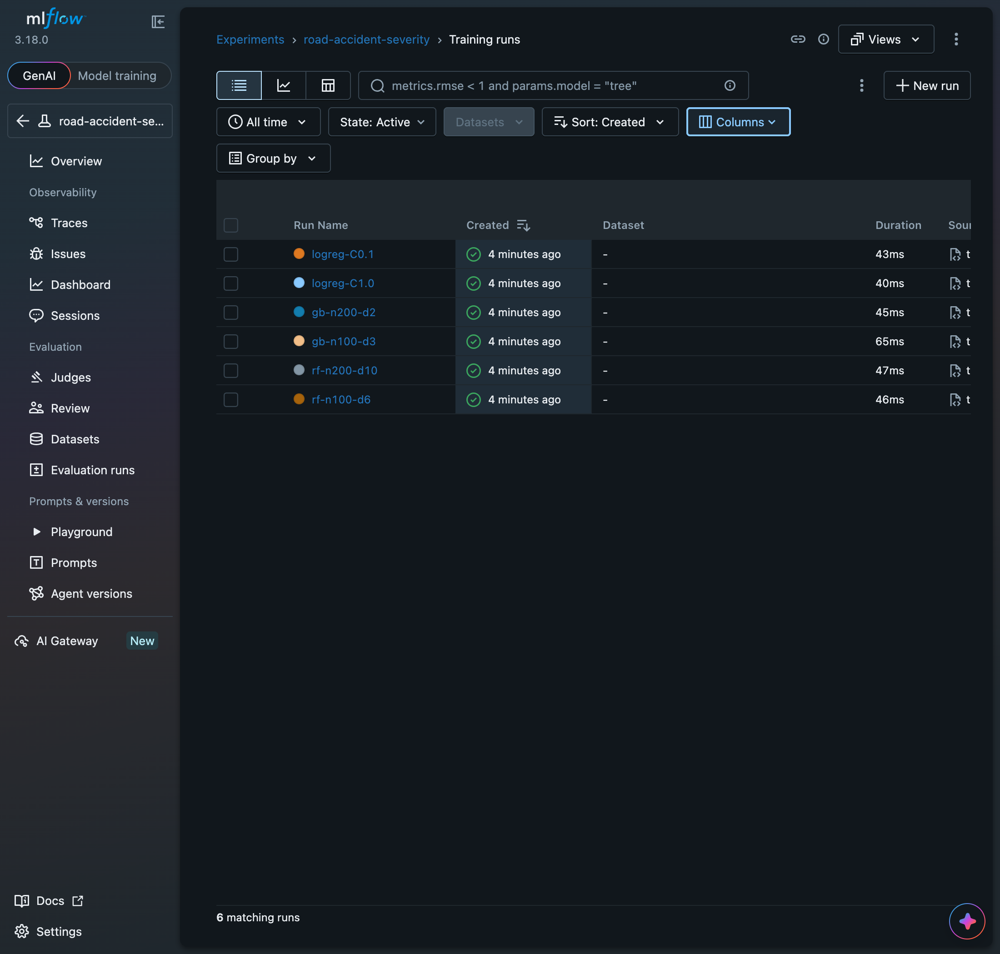
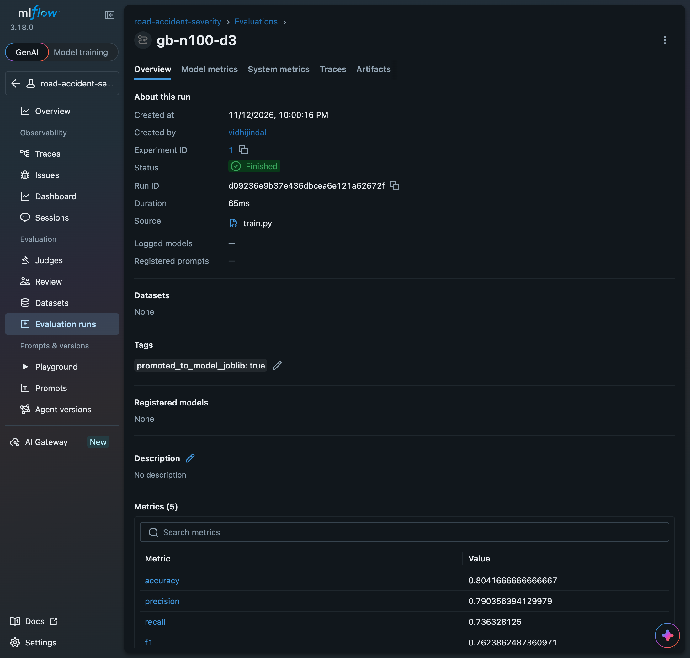
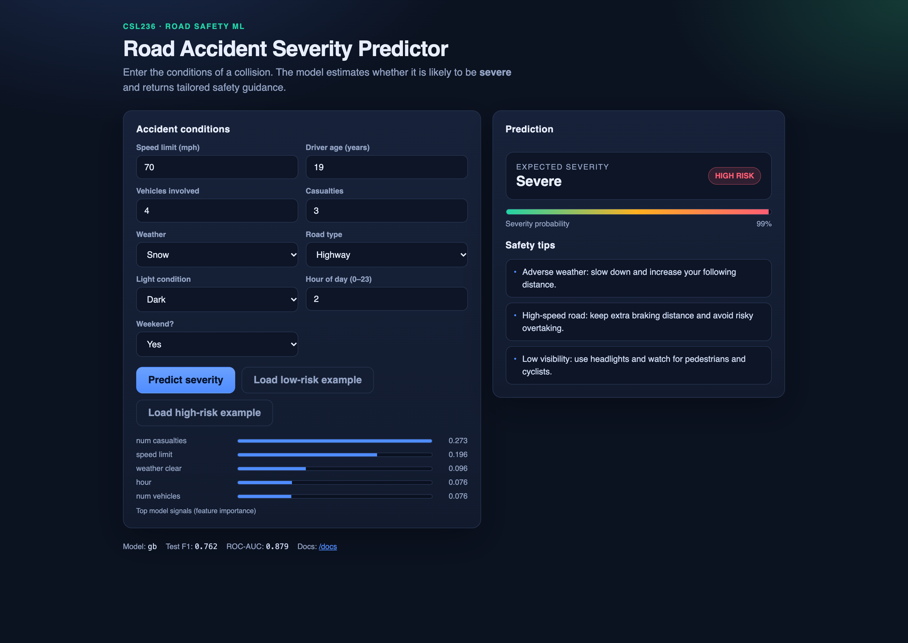
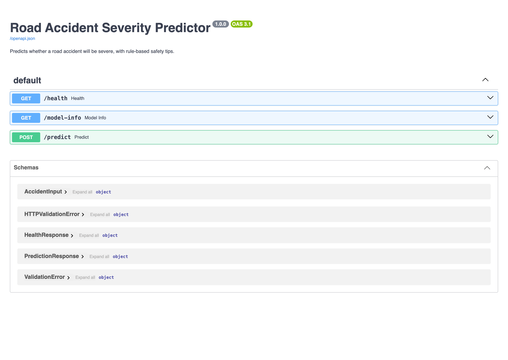
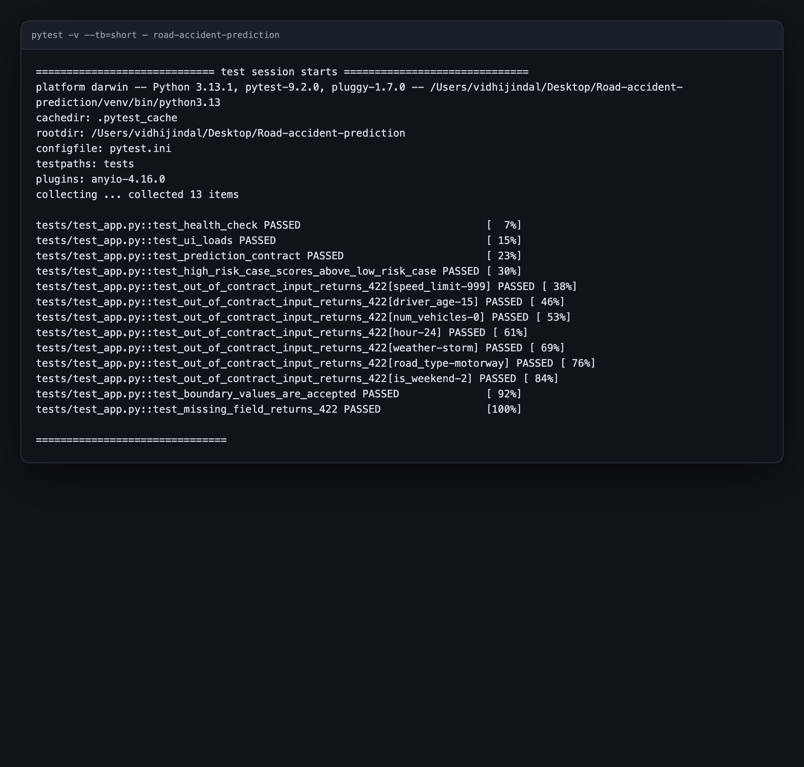
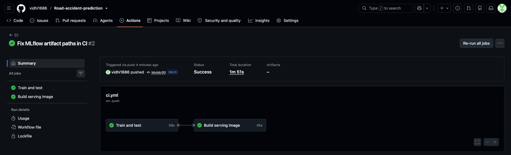

# Road Accident Severity Prediction

**Course:** CSL236 – Introduction to AI and Machine Learning, B.Tech CSE, Semester 5, The NorthCap University
**Project type:** End-term MLOps system (tracked experiments → validated API → tests → Docker → CI → deployment)

| Team member | Roll number | Contributions |
| --- | --- | --- |
| Vidhi Jindal | 24csu324 | _to be confirmed by the team_ |
| Palak Khanna | 24csu325 | _to be confirmed by the team_ |

---

## 1. Problem statement

Road collisions differ enormously in outcome: the same crash can be a minor
fender-bender or a fatal event depending on speed, weather, visibility, road
class, driver profile and time of day. Road-safety teams and emergency
responders need a fast, consistent way to triage a reported collision.

This project builds a **binary classification** system that predicts whether a
reported accident is likely to be **severe** (`severity = 1`) or **non-severe**
(`severity = 0`), given nine conditions known at report time. The service
returns a calibrated probability, a human-readable label and 2–3 rule-based
safety tips. It is exposed as a FastAPI service with a browser UI, is tested,
containerised, built in CI and ready for free-tier deployment.

**Input features:** 9 (6 numeric, 3 categorical) — above the 5-feature minimum.
**Rows:** 6,000 — above the 1,000-row minimum.
**Target:** `severity` ∈ {0, 1}.

## 2. Dataset and source

| Item | Value |
| --- | --- |
| File | `data/accidents.csv` (≈400 KB, committed) |
| Generator | `data/generate_data.py` (committed, seeded) |
| Rows | 6,000 |
| Features | 9 |
| Target | `severity` (binary) |
| Severe rate | 42.7% |
| Source | **Synthetic**, generated for this project. No third-party dataset is redistributed. |

The generator uses `numpy.random.default_rng(42)`, so the exact CSV is
reproducible with:

```bash
python data/generate_data.py --rows 6000 --seed 42
```

It samples every feature inside the contract ranges below and assigns the label
from a latent risk score that encodes domain-realistic relationships: higher
speed limits, more vehicles and casualties, rain/fog/snow, darkness, rural and
highway roads, novice/elderly drivers, and late-night weekend travel all raise
the probability of a severe outcome. This is a **synthetic benchmark**, not a
claim about real-world accident outcomes; see [Limitations](#10-limitations).

## 3. Data contract

Every constraint below is enforced by the Pydantic `AccidentInput` schema in
`app.py`. Out-of-range values, unknown categories, missing fields and extra
fields all return **HTTP 422**.

| Feature | Type | Allowed range / values | Why it matters |
| --- | --- | --- | --- |
| `speed_limit` | int | 20 – 120 (mph) | Higher impact energy raises injury severity |
| `num_vehicles` | int | 1 – 10 | Multi-vehicle pile-ups increase harm |
| `num_casualties` | int | 0 – 10 | Direct severity signal in the report |
| `driver_age` | int | 16 – 90 | Novice and elderly drivers have higher risk |
| `weather` | categorical | `clear`, `rain`, `fog`, `snow` | Grip and visibility degrade in bad weather |
| `road_type` | categorical | `urban`, `rural`, `highway`, `intersection` | Road class changes speed and conflict patterns |
| `light_condition` | categorical | `daylight`, `dark`, `dusk` | Visibility affects reaction time |
| `hour` | int | 0 – 23 | Night-time and rush-hour risk varies |
| `is_weekend` | int | 0 or 1 | Weekend travel changes traffic mix |
| `severity` | target (binary) | 0 or 1 | Label: 1 = severe accident |

`schema.py` is the single source of truth: `train.py` trains on exactly these
columns and `app.py` validates exactly these columns.

## 4. Repository layout

```
Road-accident-prediction/
├── data/
│   ├── accidents.csv           # 6,000-row dataset (committed)
│   └── generate_data.py        # documented, seeded generator
├── model/
│   ├── model.joblib            # serialized best pipeline (imputer + model)
│   └── metrics.json            # metadata of the promoted model
├── static/
│   └── index.html              # prediction UI
├── tests/
│   └── test_app.py             # 13 pytest cases
├── docs/
│   ├── screenshots/            # UI, /docs, MLflow, pytest evidence
│   ├── pytest_output.txt       # captured pytest -v output
│   └── sample_predictions.jsonl# sample of the production prediction log
├── .github/workflows/
│   └── ci.yml                  # install → train → pytest → docker build
├── app.py                      # FastAPI app + Pydantic schema
├── schema.py                   # shared feature contract
├── train.py                    # CLI training with MLflow tracking
├── drift_check.py              # bonus: input-drift monitor
├── Dockerfile                  # python:3.11-slim serving image
├── requirements.txt            # full dev/training environment
├── requirements-serve.txt      # lean serving runtime
├── pytest.ini
├── render.yaml                 # one-click Render deployment blueprint
├── .gitignore
└── README.md
```

## 5. Setup and run

### Local (Python 3.11+)

```bash
python3 -m venv venv && source venv/bin/activate
pip install -r requirements.txt

# 1. Data (already committed; regenerate if you want)
python data/generate_data.py

# 2. Train (writes MLflow runs + promotes the best model)
python train.py --algorithm gb --n_estimators 100 --max_depth 3 --learning_rate 0.1

# 3. Explore experiments
mlflow ui --backend-store-uri sqlite:///mlflow.db
# open http://127.0.0.1:5000

# 4. Serve
uvicorn app:app --reload --port 8000
# UI:   http://127.0.0.1:8000/
# Docs: http://127.0.0.1:8000/docs
```

> **macOS note:** AirPlay Receiver occupies port 5000. Use
> `http://127.0.0.1:5000` (not `localhost:5000`) or start MLflow with
> `--port 5001`.

### Docker

```bash
docker build -t road-accident-prediction .
docker run -d -p 8000:8000 --restart unless-stopped road-accident-prediction
```

Image size: **757 MB** (`python:3.11-slim` + NumPy/pandas/scikit-learn).
The image installs `requirements-serve.txt` only — no MLflow, no pytest.

### Example request

```bash
curl -X POST http://127.0.0.1:8000/predict \
  -H "Content-Type: application/json" \
  -d '{
    "speed_limit": 70, "num_vehicles": 4, "num_casualties": 3,
    "driver_age": 19, "weather": "snow", "road_type": "highway",
    "light_condition": "dark", "hour": 2, "is_weekend": 1
  }'
```

```json
{
  "prediction": 1,
  "label": "Severe",
  "severity_probability": 0.9945,
  "tips": [
    "Adverse weather: slow down and increase your following distance.",
    "High-speed road: keep extra braking distance and avoid risky overtaking.",
    "Low visibility: use headlights and watch for pedestrians and cyclists."
  ]
}
```

## 6. Experiment tracking (MLflow)

`train.py` takes every hyperparameter as a CLI flag and logs params + metrics to
a SQLite-backed MLflow store (`mlflow.db`, committed so evaluators can browse
the history). Six runs across three algorithms were executed on the same
stratified 80/20 split (`random_state=42`).

| Run | Algorithm | Hyperparameters | Accuracy | Precision | Recall | F1 | ROC-AUC |
| --- | --- | --- | ---: | ---: | ---: | ---: | ---: |
| `rf-n100-d6` | Random Forest | `n_estimators=100, max_depth=6` | 0.7758 | 0.7806 | 0.6602 | 0.7153 | 0.8512 |
| `rf-n200-d10` | Random Forest | `n_estimators=200, max_depth=10` | 0.7942 | 0.7789 | 0.7227 | 0.7497 | 0.8646 |
| **`gb-n100-d3`** | **Gradient Boosting** | **`n_estimators=100, max_depth=3, lr=0.1`** | **0.8042** | **0.7904** | **0.7363** | **0.7624** | **0.8791** |
| `gb-n200-d2` | Gradient Boosting | `n_estimators=200, max_depth=2, lr=0.05` | 0.7975 | 0.7930 | 0.7109 | 0.7497 | 0.8747 |
| `logreg-C1.0` | Logistic Regression | `C=1.0` | 0.7867 | 0.7689 | 0.7148 | 0.7409 | 0.8641 |
| `logreg-C0.1` | Logistic Regression | `C=0.1` | 0.7858 | 0.7673 | 0.7148 | 0.7401 | 0.8634 |

**Chosen model:** Gradient Boosting (`n_estimators=100`, `max_depth=3`,
`learning_rate=0.1`), promoted to `model/model.joblib`. It has the best F1
(0.7624) and ROC-AUC (0.8791) of all six runs, captures non-linear interactions
that logistic regression cannot, needs no feature scaling for inference, and
produces directly usable feature importances for the UI. The deeper random
forest slightly overfits (more trees/depth, lower F1), so the shallow boosted
model is preferred.

`train.py` only promotes a new model when it beats `model/metrics.json` on test
F1, so the committed artifact is always the best run so far.




## 7. API and UI

| Endpoint | Method | Description |
| --- | --- | --- |
| `/` | GET | Prediction UI (`static/index.html`) |
| `/health` | GET | Liveness probe → `{"status":"ok","model_loaded":true}` |
| `/predict` | POST | Validated prediction + probability + tips |
| `/model-info` | GET | Algorithm, test metrics, top feature importances |
| `/docs` | GET | Interactive OpenAPI docs |

- The model is loaded **once at process start** (`MODEL = joblib.load(...)`),
  never per request.
- Every prediction is appended as JSON to `logs/predictions.jsonl`
  (timestamp, all inputs, output, probability and tips) for drift analysis.
  A committed sample is in `docs/sample_predictions.jsonl`.
- The UI shows the verdict, probability meter, tips, and the top model signals.




## 8. Automated tests

```bash
pytest -v --tb=short
```

13 passing tests, including:

1. `test_health_check` — `/health` returns ok and reports the model loaded.
2. `test_ui_loads` — `/` serves the HTML UI.
3. `test_prediction_contract` — response fields, probability range, 2–3 tips.
4. `test_high_risk_case_scores_above_low_risk_case` — **domain logic**: the
   70 mph / snow / dark / 3-casualty case (0.9945) must beat the 25 mph /
   clear / daylight / 0-casualty case (0.0141) by a wide margin.
5. `test_out_of_contract_input_returns_422` — seven parametrized boundary
   violations (speed 999, age 15, vehicles 0, hour 24, unknown weather/road,
   weekend 2) all return 422.
6. `test_boundary_values_are_accepted` — legal extremes (120 mph, age 16,
   hour 0) return 200.
7. `test_missing_field_returns_422` — absent required field returns 422.



## 9. CI/CD and deployment

## Continuous Integration

`.github/workflows/ci.yml` runs on every push to `main` and on pull requests:

1. Install `requirements.txt` (Python 3.11).
2. Regenerate the dataset.
3. Train a baseline gradient-boosting model (evidence that training works from
   a clean checkout).
4. Run `pytest -v --tb=short`.
5. Build the serving Docker image.



### Deployment (Render / Railway / EC2)

The image is deployment-ready and starts with `uvicorn app:app --host 0.0.0.0
--port 8000`; `render.yaml` is included for a one-click Render deploy.

Render:

1. New → Web Service → connect this repository.
2. Runtime: Docker (auto-detected from `Dockerfile`).
3. Health check path: `/health`.
4. Deploy; the service restarts automatically on failure/crash.

Railway: New Project → Deploy from repo → Dockerfile → generate a domain.

EC2:

```bash
docker run -d -p 80:8000 --restart unless-stopped road-accident-prediction
```

**Live URL:** https://road-accident-prediction-day1.onrender.com

### Monitoring / drift

```bash
python drift_check.py
```

Compares the mean of each numeric feature in `logs/predictions.jsonl` against
the training CSV (in training standard deviations) and the total-variation
distance for categoricals. Exits non-zero when a feature crosses the threshold
(0.5 σ / 0.2 TVD), so it can be scheduled as a cron check.

## 10. Limitations

- The dataset is **synthetic**; metrics measure how well the model recovers the
  generator's risk structure, not real-world accident outcomes.
- The label uses features that would be known at report time; a real deployment
  would need temporal validation and a proper drift-monitoring cadence.
- `severity` is treated as binary; a multi-class injury-severity target would
  be a natural extension.

## 11. Submission checklist

| Requirement | Status / evidence |
| --- | --- |
| Public GitHub repository | _push this repo; add link_ |
| Live deployment URL | _deploy to Render; add URL_ |
| PPT + PDF report | _to be prepared for the portal_ |
| README: problem, dataset, contract | Sections 1–3 |
| README: setup local + Docker | Section 5 |
| README: MLflow results table | Section 6 |
| README: model choice + why | Section 6 |
| README: screenshots (UI, docs, MLflow, pytest) | Sections 6–8 |
| README: team + contributions | Header table (fill in) |
| 8 technical stages | Stages 1–8 below |
| Bonus: drift check + feature importances in UI | `drift_check.py`, `/model-info`, UI bars |

| Stage | Evidence |
| --- | --- |
| 1 Environment isolation | `venv/` ignored; pinned `requirements.txt`; fresh install verified |
| 2 Experiment tracking | `train.py` CLI args; 6 MLflow runs; `mlflow.db` committed |
| 3 Model serialization | `model/model.joblib`, loaded once at startup |
| 4 API + UI | `/health`, `/predict`, `/`, `/docs`; screenshot above |
| 5 Automated tests | 13 passing; screenshot above |
| 6 Docker | `python:3.11-slim`, 757 MB, container smoke-tested |
| 7 CI | GitHub Actions workflow: install → train → pytest → docker build |
| 8 Deployment + monitoring | `render.yaml`, restart policy, `logs/predictions.jsonl`, `drift_check.py` |

---

### Reproduce the full pipeline

```bash
python3 -m venv venv && source venv/bin/activate
pip install -r requirements.txt
python data/generate_data.py
python train.py --algorithm rf  --n_estimators 100 --max_depth 6
python train.py --algorithm rf  --n_estimators 200 --max_depth 10
python train.py --algorithm gb  --n_estimators 100 --max_depth 3 --learning_rate 0.1
python train.py --algorithm gb  --n_estimators 200 --max_depth 2 --learning_rate 0.05
python train.py --algorithm logreg --C 1.0
python train.py --algorithm logreg --C 0.1
pytest -v --tb=short
docker build -t road-accident-prediction .
docker run -d -p 8000:8000 --restart unless-stopped road-accident-prediction
```
